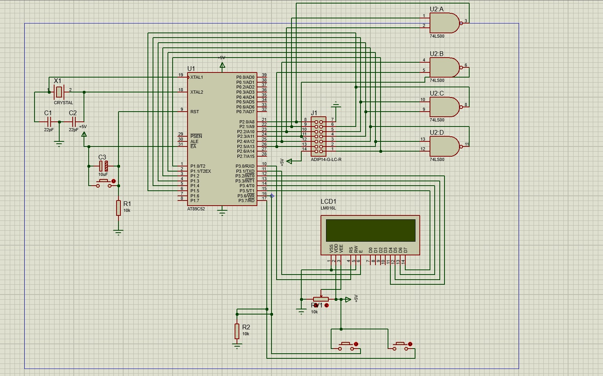

# Description

An 8051-based digital logic IC tester built around the AT89S52 microcontroller, designed to perform automated truth-table verification of 14-pin 74LS-series combinational logic ICs. The current hardware implementation supports the 74LS00 NAND, 74LS02 NOR, and 74LS04 NOT ICs, using a 14-pin ZIF socket, 16×2 LCD, single-button control, and LED status indicators. It operates from a 5V supply generated by an MT3608 boost converter powered by a Li-ion battery.

## Components

| Component | Specification | Qty. | Purpose |
|---|---|---:|---|
| AT89S52 MCU | 8-bit 8051, DIP-40, 8 KB Flash, 256 B RAM | 1 | Main controller for test generation, response reading and result processing |
| DIP-40 IC Socket | 40-pin DIP socket | 1 | Removable socket for AT89S52 |
| ZIF Socket | 14-pin ZIF | 1 | Holds the 14-pin DUT during testing |
| 16×2 LCD | HD44780-compatible character LCD | 1 | Displays IC selection, status and test results |
| Crystal | 12 MHz | 1 | AT89S52 clock source |
| Ceramic Capacitors | 22 pF | 2 | Crystal oscillator load capacitors |
| Ceramic Capacitor | 100 nF | 1 | Local supply decoupling for AT89S52 |
| Electrolytic Capacitors | 10 µF | 2 | Supply filtering and reset circuit |
| Resistor | 10 kΩ | 1 | Reset circuit pull-down |
| Potentiometer | 10 kΩ | 1 | LCD contrast adjustment |
| Resistors | 330 Ω | 2 | LED current limiting |
| Push Buttons | Momentary, normally open | 2 | IC test/selection and microcontroller reset |
| Power Switch | SPST | 1 | Main power control |
| Green LED | Green | 1 | Indicates successful IC test |
| Red LED | Red | 1 | Indicates failed IC test |
| Li-ion Battery | 3.7 V | 1 | Portable power source |
| Boost Converter | MT3608, 5 V output | 1 | Generates regulated 5 V from Li-ion cell |
| Arduino Uno | ISP programming interface | 1 | Interface used to program the AT89S52 |
| 74-Series ICs | 7400 NAND, 7402 NOR, 7404 NOT | 3 | Device-under-test ICs for functional verification |
| Perfboard | General-purpose prototype board | 2 | Hardware assembly |
| Berg Strips | Male-to-male | 2 | Breadboard/perfboard interconnections |
| Berg Strips | Female-to-male | 2 | Interconnections and header access |


## Circuit and Connections


1. Power Supply
* 3.7V Li-ion battery → MT3608 input (+/−)
* MT3608 output (+) → Main switch → +5V rail
* MT3608 output (−) → Common GND
* AT89S52 pin 40 → +5V
* AT89S52 pin 20 → GND
* AT89S52 pin 31 (EA) → +5V

2. Crystal and Reset
* 12MHz crystal between AT89S52 pins 18 (XTAL2) and 19 (XTAL1)
* 22pF capacitor from pin 18 to GND
* 22pF capacitor from pin 19 to GND
* 10µF capacitor: positive → +5V, negative → pin 9 (RST)
* 10kΩ resistor from pin 9 (RST) to GND
* Reset push button between +5V and pin 9

3. LCD (16×2, 4-bit mode)
* VSS (pin 1) → GND
* VDD (pin 2) → +5V
* V0 (pin 3) → Centre pin of 10kΩ potentiometer
* Potentiometer outer pins → +5V and GND
* RS (pin 4) → AT89S52 pin 10 (P3.0)
* RW (pin 5) → GND
* E (pin 6) → AT89S52 pin 11 (P3.1)
* D4 (pin 11) → AT89S52 pin 12 (P3.2)
* D5 (pin 12) → AT89S52 pin 13 (P3.3)
* D6 (pin 13) → AT89S52 pin 14 (P3.4)
* D7 (pin 14) → AT89S52 pin 15 (P3.5)
* LCD D0–D3 → Unconnected
* BLA (backlight +) → +5V 
* BLK (backlight −) → GND

4. Control Button
* One push button only: AT89S52 pin 17 (P3.7) → Push button → GND
* Pin 16 (P3.6) → Unused
* No external pull-up resistor normally needed on P3.7.

Button functions:
* Short press → Test selected IC
* Hold for approximately 1 second → Select next IC
* IC selection order: 7402 → 7404 → 7400 → Repeat

5. LEDs (Active LOW)
* Green LED → AT89S52 pin 38 (P0.1) — PASS
* Red LED → AT89S52 pin 39 (P0.0) — FAIL

For each LED:
* +5V → Separate 330Ω series resistor → LED anode (+)
* LED cathode (−) → Assigned MCU pin

6. Decoupling Capacitors
* 100nF ceramic capacitor between AT89S52 pins 40 (+5V) and 20 (GND) — installed
* 10µF electrolytic capacitor across main +5V and GND rails — installed
* 10µF electrolytic capacitor in reset circuit — installed
* Two 22pF capacitors connected to the crystal terminals — installed

7. 14-pin ZIF Socket
* ZIF pin 1 → AT89S52 pin 1 (P1.0)
* ZIF pin 2 → AT89S52 pin 2 (P1.1)
* ZIF pin 3 → AT89S52 pin 3 (P1.2)
* ZIF pin 4 → AT89S52 pin 4 (P1.3)
* ZIF pin 5 → AT89S52 pin 5 (P1.4)
* ZIF pin 6 → AT89S52 pin 6 (P1.5)
* ZIF pin 7 → GND
* ZIF pin 8 → AT89S52 pin 27 (P2.6)
* ZIF pin 9 → AT89S52 pin 26 (P2.5)
* ZIF pin 10 → AT89S52 pin 25 (P2.4)
* ZIF pin 11 → AT89S52 pin 24 (P2.3)
* ZIF pin 12 → AT89S52 pin 23 (P2.2)
* ZIF pin 13 → AT89S52 pin 22 (P2.1)
* ZIF pin 14 → +5V

## Programming 8051

#### Requirements
* SDCC
* `packihx`
* Python 3
* Python `pyserial` - start a vev, ```pip install pyserial```
* Arduino Uno used as ISP programmer: upload /src/at89s-isp.ino sketch to arduino uno
```bash
sudo apt install python3-serial
```
#### Build 8051 firmware hex 
From `src/`:
```bash
mkdir -p build
sdcc --model-small -o ./build/ ./firmware_allics.c
packihx ./build/firmware_allics.ihx > ./build/firmware_allics.hex
```
The compiled firmware is: (pre-built at /src/build)
```text
build/firmware_allics.hex
```
#### Flash 8051 Firmware hex
Connect the Arduino Uno ISP to the AT89S52, then run:
```bash
python3 flash.py ./build/firmware_allics.hex
```

## Usage

1. Switch on the tester.
2. Insert a supported IC into the ZIF socket, with power switched off.
3. Switch on the tester. The LCD displays the selected IC.
4. **Long press (approximately 1 second):** Select the next IC.
5. **Short press:** Test the selected IC.
6. Check the LCD and LEDs for the test result.

**IC Selection Order:** 7402 NOR → 7404 NOT → 7400 NAND → Repeat.
**Supported ICs:** 7400 (NAND), 7402 (NOR), 7404 (NOT).

**LED Indicators:**
- Green LED — PASS
- Red LED — FAIL

**Safety:** Switch off the tester before inserting or removing an IC from the ZIF socket.

